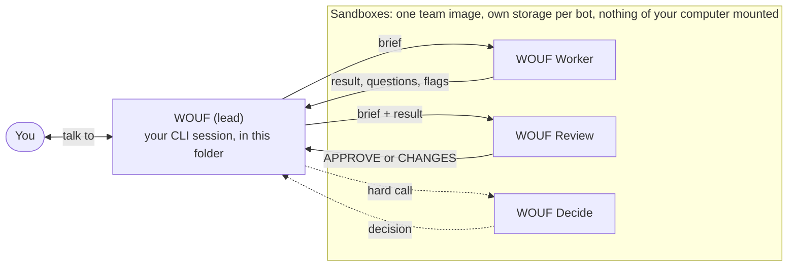

# WOUF

**An agent team in a folder, set up with the AI tool you already use.**

WOUF runs AI agents as a team with a real separation of roles (one lead you talk to in your own agent CLI, a worker who makes the change, an independent reviewer who checks it), the bots each in their own isolated sandbox (a Docker or Podman container, or `bwrap` on Linux; with `mode = host`, without one), with a model-free gate (checks that run before any review), an egress allowlist (with `network = egress`, a bot reaches only the hosts it is allowed) and signed receipts for each landed change, exportable to in-toto. It is plain standard-library Python.

```bash
git clone https://github.com/vaiev/wouf.git && cd wouf && python3 .agents/bin/team demo
```

The demo runs offline and shows the model-free gate, an approval tied to an exact commit, a signed receipt verified offline, and a tampered copy refused (Python 3.9+ and git; the receipt step needs `ssh-keygen` and is skipped without it).

It is a folder of plain instructions plus six small standard-library Python helpers (`team`, `log`, `secret`, `project`, `federate`, `guard`), which you copy into a project and use with Claude Code, Codex CLI, Antigravity (agy), Grok Build or any agent CLI that reads `AGENTS.md`. Bots run on Claude Code, Codex CLI or Antigravity. WOUF is only the example name; call your team whatever you like.

## A receipt for each landed change

Once the team has a signing key, the lead makes a receipt after each change lands, with `team receipt make`: a small signed file with the facts of that change. It shows that the files that landed are exactly the files that were tested and reviewed, which reviewers approved that exact version, and that the automatic checks (the gate) passed on it. If the command refuses, for example because a check is missing, the change stays merged without a receipt and the lead writes down why.

The receipt is signed with the team's SSH key, the same key that signs its messages to other teams (federation). Anyone with the team's public key can check it on their own computer, without a network, with `team verify SHA --signers FILE`, where SHA is the landed commit and FILE holds the team's public key in the form [docs/RECEIPTS.md](docs/RECEIPTS.md) shows; a copy with one field changed is refused, as the demo shows. To check, you need the WOUF pack (Python 3.9+), git, OpenSSH 8.7 or newer, and a copy (clone) of the repository with the receipt notes, `refs/notes/wouf-receipts`, fetched. In a clone that holds the landed and reviewed commits (as `team demo` shows, or your own team's repository), `team verify` prints `verified` (exit 0); the public vaiev/wouf repository is a fresh-history export, so for the receipts of the development repository a clone of it prints `partial` (exit 3): the signature and the record check out, but the reviewed and landed commits are not in that clone. It also exports to in-toto, a format that supply-chain security tools read (`team receipt export SHA --in-toto`).

The fingerprint of the key that signs WOUF's own receipts is `SHA256:kQfxHJ5w0JRzMT4JIburS5E0zGHlwk47+Zvauk5Ac1w` (key type ED25519); it is published in this repository and on wouf.dev, and a careful user compares it with a second copy, for example the release note of the tag, and with the one `team verify` prints before trusting it. A receipt shows what the team recorded and signed, not that the code is right. How it works and what it does not prove: [docs/RECEIPTS.md](docs/RECEIPTS.md).

## Quickstart (no technical background needed)

1. **Have an AI assistant for the terminal.** If you have none yet, install one, for example [Claude Code](https://code.claude.com/docs), and sign in once.
2. **Make a folder for your work and open it in the terminal.** On a Mac: create the folder in Finder, right-click it, "New Terminal at Folder". Then start your assistant there (for Claude Code type `claude`).
3. **Paste this sentence:**

   > Set up the agent team from <https://github.com/vaiev/wouf/blob/main/INSTALL.md> in this folder. I am not technical: explain in plain words and do the steps for me.

The assistant sets everything up in that folder and asks you a few questions, each with a recommendation; answering "yes" is fine. If something is missing on your computer (for example the program that gives the bots their sandboxes), it tells you what, why, and installs it with you. One step it will ask you to do yourself: typing your key into the terminal, so that no key ever ends up in a chat.

Afterwards you just talk: "WOUF, what can you do?" or "WOUF, write me a short welcome text for my website and show it to me before anything is published."

## How it works



- **You talk to the lead**, in this folder, with the CLI you use: "WOUF, change the invoice template and remind me on Friday to send it."
- **The lead does not do the work.** It writes a short brief and says "I passed this to WOUF Worker." The worker runs as a headless agent CLI in a sandbox; the lead copies the brief in and the result out.
- **Bots talk to the lead, never to you**: "WOUF, I need the logo file from the user." The lead collects these and asks you once.
- **Code is reviewed** by a second bot in a fresh context. It comes back as a git branch; nothing reaches your main branch without an APPROVE on its exact head, green CI and your yes. The task classes `decision`, `analysis` and `plan` have no review step by default: their result is a document, and the lead has it reviewed by hand before anything relies on it.
- **Bots speak up** when something is wrong, missing, risky or could be done better. With `autonomy = auto` the lead decides such things with the decide bot and tells you afterwards; anything irreversible, outward, paid or needing new access still waits for you.
- **A whole task can run on its own**: `team flow <task>` takes a brief through worker, a pre-gate without any model (allowed paths, then the `[flow] gate` command, your tests, in a sandbox; with no gate set, the paths only), review and rework to `ready` (with a review step: an APPROVE on the exact head), `blocked` or one question, picking bot, model and effort from the brief's `Class:`. It waits out usage limits or switches to another CLI, and continues where it stopped.
- **Everything is a file**: board, decisions, schedule, knowledge, and one log line per run, searchable with `.agents/bin/log`.

### Where the bots run

The team shares one computer image that holds the agent CLIs and tools, installed once. Every bot has its own storage, so its notes and work survive between tasks and stay apart from the other bots. A bot's container exists only while it works on a task: nothing runs and nothing is used while the team is idle, several bots can work at the same time, and a bot that runs too long is stopped. Your files, your keys and your other projects are never mounted.

This needs a container engine: Docker, Podman, OrbStack or Colima on your computer, or Docker on a small VM or server. If you have none, the setup recommends one for your system and installs it with you. To only try things out, `host` mode runs the bots on your computer without a sandbox.

## Set it up (technical)

Open your agent CLI in the project folder and say:

> Set up the agent team from <https://github.com/vaiev/wouf/blob/main/INSTALL.md> in this folder.

The agent follows [INSTALL.md](INSTALL.md): it copies `.agents/` into the folder (nothing global except your per-user secret store, `~/.config/wouf/secrets` or the system keyring), adds one line to `AGENTS.md` and the adapter your CLI needs, asks one round of questions (where bots run, which agent CLI and models, keys, name, autonomy and test command), creates the bots and runs `.agents/bin/team doctor` and a smoke test.

Requirements: an agent CLI, Python 3.9+, git, and for the sandboxes Docker or Podman (locally or through `docker_host = ssh://<alias>`).

## Use it

- Talk to the lead by name: "WOUF, what is open?" "WOUF, every Monday at 8, summarise last week's issues as a draft." "WOUF, use Codex for the worker."
- Start a session with "without WOUF" when you want your CLI without the team.
- Let a task run on its own: "WOUF, run T-12 as a flow." You hear back when it is ready, blocked or has a question.
- Hand over a goal too big for one task: the planner bot turns it into a plan and draft tasks, and the lead reads and adjusts them before any of them runs.
- Ask for more bots when work keeps coming up ("we need a research bot"); examples are ready: research, writer, tester, ops.
- Ask for connectors when a bot needs a service ("give the tester a browser"); examples are ready: GitHub, Context7 (library docs), Playwright (browser), Memory. They are off until you say yes, and only the bot that has one gets its configuration and keys (in a container or bwrap sandbox; in `host` mode a run's environment also carries every registered value, for masking its log, so there this separation does not hold); what a connector installs goes into the image all bots share.
- Ask the lead to stop or reset a bot, or to export the team for another computer or person (without keys and, unless you ask, without data). With data, the event log, flows, goals, the lead's briefs and practice files move only into a new team without events; bots arrive `proposed`, settings are copied by hand, and bot storage, logins and keys stay behind.

## Make it yours

| What | Where |
|---|---|
| Name, autonomy, where bots run, agent CLIs and models, time limit | `.agents/team/config.ini` |
| Your bots | `.agents/team/bots/<id>.md` |
| Example bots and connectors (off until turned on) | `.agents/bots/`, `.agents/connectors/` |
| Rules every member follows | `.agents/rules.md` |
| Roles: lead, worker, review, decide, specialist | `.agents/roles/` |
| Skills: setup, brief, dispatch, review and merge, clock, secrets, team, toolkit | `.agents/skills/` |
| Board, decisions, schedule, knowledge, logs, team skills, tools for the image | `.agents/team/` |
| Helpers: `team` (bots, runs, doctor), `log` (run records and search), `secret` (keys), `project` (a task's phases), `federate` (peer leads), `guard` (the lead's tripwire) | `.agents/bin/` |

Everything outside `.agents/team/` is the shared pack; an update replaces the pack files recorded in `.agents/team/.pack-files` and leaves your team and your own files in `.agents/` as they are.

## Built with WOUF

WOUF builds [Vaikor](https://github.com/vaiev/vaikor), and it builds itself: its own hardening tasks ran through `team flow` on this repository. That team:

| Role | Agent CLI | Model |
|---|---|---|
| Lead | Claude Code | Claude Opus 5.5 |
| Worker, bugfixer | Claude Code | Claude (strong or light tier per task class) |
| Review | Codex CLI | default Codex model, high effort |
| Scout | Antigravity CLI | Gemini 4 Argon |

The owner sets the direction, answers the questions the lead collects, and decides what goes public. The code and documentation of this repository are written by this agent team under the owner's lead. The lead merges pull requests in the private development repository itself, under the owner's standing OK, once a reviewer approved the exact head commit and CI is green. [docs/examples/T-0001.md](docs/examples/T-0001.md) follows one task from brief to approval, including a red gate and a worker that stopped and asked.

## Limits

- The rules are instructions to the models. The real boundary is the sandbox: nothing of your computer is mounted into a bot's container, a bot's results come back as plain files only (links are skipped), and the container has no root capabilities. `host` mode has no sandbox.
- What a bot prints and hands back is shown to the lead as data, not as instructions; the lead is told so, but it is still a model reading text a bot wrote.
- Bots need internet access to reach cloud models; the default `bridge` network is not filtered, so a bot can reach your local network and, on a cloud VM, the provider's metadata service. Block those on the engine's host if that matters, or use `network = egress` to filter the bot's traffic through an allowlist proxy; the run's allowed hosts are shown at its start (see [limits](docs/guide/limits.md)).
- `.agents/bin/secret` keeps keys out of the repository, the chat and the bots' storage. A process running as your own user could still read its store. Masking keys in a bot's output prevents accidents; it is not a barrier against a bot that wants to leak a key it was given.
- Known gaps are listed in `docs/DESIGN.md` under "Secrets at the sinks": only key patterns and registered values are recognized, as they stand (a value a bot reflows, splits, encodes or compresses, or one that is neither registered nor key-shaped, passes), a registered multi-line value longer than the stream buffer (400 lines) may pass in streamed output, and a value containing `/` is not masked in a path.
- The container flow is tested with Docker and a stand-in CLI. The commands for the real agent CLIs and the example connectors in `config.ini` and `.agents/connectors/` follow their documentation; check them against your versions.
- For a local model, the local-runner (`python3 catalog/tools/local-runner/local_runner.py`) checks a model server that speaks the OpenAI-compatible API and smoke-tests one chat completion; with `network = egress`, `[egress] private` lets a bot reach that one host and port.
- A whole team run on a local model with tool calls is not tested yet.
- Gemini CLI gets an adapter file for the lead but is not tested.

## Catalog

`catalog/` holds optional examples: platform skills (OpenStack, DNS, backups, secrets), a knowledge hub and an MCP control-server template. It is off by default and outside the pack; teams copy what they need (see [catalog/README.md](catalog/README.md)).

## Develop

```bash
python3 -m unittest discover -s tests -v
```

The container tests run when Docker or Podman is reachable. `scripts/install-smoke.sh SRC` follows [INSTALL.md](INSTALL.md) in empty folders (CI runs it in `python:3.9-slim` and `ubuntu:24.04`; `tests/test_install_smoke.py` does the same locally). See [CONTRIBUTING.md](CONTRIBUTING.md), [SECURITY.md](SECURITY.md), [CODE_OF_CONDUCT.md](CODE_OF_CONDUCT.md) and [docs/DESIGN.md](docs/DESIGN.md).

## License

Copyright 2026 VAIEV. Licensed under the [Apache License, Version 2.0](LICENSE). A redistribution, or a work built on WOUF, carries the [NOTICE](NOTICE) file.
